# Project reference

The earlier main-branch README is preserved below for detailed settings, historical results and workflow examples. Commands are written for the repository root. Some local paths reflect the original research environment; use the current root README for the main-branch setup.

---

# A-Share Alpha Factor Lab · Alpha158 & 国泰君安 GTJA-191

从零构建 **Alpha158**（qlib）与 **国泰君安 Alpha-191** 两套因子库，在 A 股（Tushare Pro，2014–2026）上做完整的
**有效性 / 相关性 / 市值·指数分组 / 分年趋势 / 持有期 / 单因子分层回测**，再叠加一套
**LightGBM 走查（walk-forward）机器学习选股 + 组合权重优化**，并对比不同**股票池 × 调仓频率**。

> From-scratch construction of the **Alpha158** and **Guotai-Junan Alpha-191** factor libraries, a full
> factor-effectiveness study on China A-shares, and a walk-forward **LightGBM** stock-selection strategy
> with mean-variance weight optimization. Data via Tushare Pro. **Research / education only.**

---

## 目录 Contents
- [数据 Data](#数据-data)
- [1. 因子构造与有效性 Factor construction & effectiveness](#1-因子构造与有效性)
- [2. 因子在哪里有效 Where factors work](#2-因子在哪里有效)
- [3. 信号持续性与调仓频率 Persistence & rebalancing](#3-信号持续性与调仓频率)
- [4. 单因子 10 分层回测 Single-factor decile backtest](#4-单因子-10-分层回测)
- [5. LightGBM 走查选股 ML strategy](#5-lightgbm-走查选股)
- [6. 组合权重优化 Weight optimization](#6-组合权重优化)
- [7. 股票池 × 频率 对比 Universe × frequency](#7-股票池--频率-对比)
- [核心结论 Key findings](#核心结论-key-findings)
- [代码结构 Repo structure](#代码结构-repo-structure)
- [如何运行 How to run](#如何运行-how-to-run)
- [局限与免责 Caveats & disclaimer](#局限与免责-caveats--disclaimer)

---

## 数据 Data
- **来源**：Tushare Pro（`daily` / `adj_factor` / `daily_basic` / `index_weight`），日频。
- **区间**：2014-10 → 2026-07（约 11.8 年，2,859 个交易日）。
- **票池**：全 A **5,787** 只（全市场版）；因子研究默认用四大指数并集 **3,497** 只，ML 默认 **中证1000** 成分（剔最小 10% 市值）。
- **口径**：价格**后复权**（raw × adj_factor）；市值 `total_mv`；指数成分**逐月时变**。
- 因子只用**日频量价**（OHLC、vwap、成交量、成交额）；市值/指数成分只用于分组，不进因子。

---

## 1. 因子构造与有效性

- **Alpha158**：忠实复刻 qlib 的 158 个因子（9 K线形态 + 4 归一化价格 + 29 滚动算子 × 5 窗口）。
- **GTJA-191**：国泰君安短周期量价 191 个 formulaic alpha，**186 个**可由纯量价算出（5 个需 Fama-French/基准输入，跳过）。
- **有效性**：日度截面 **Spearman rank-IC**（1/5/10 日），并用开源包 **alphalens-reloaded** 独立复核（误差 ~0.002）。

<p align="center">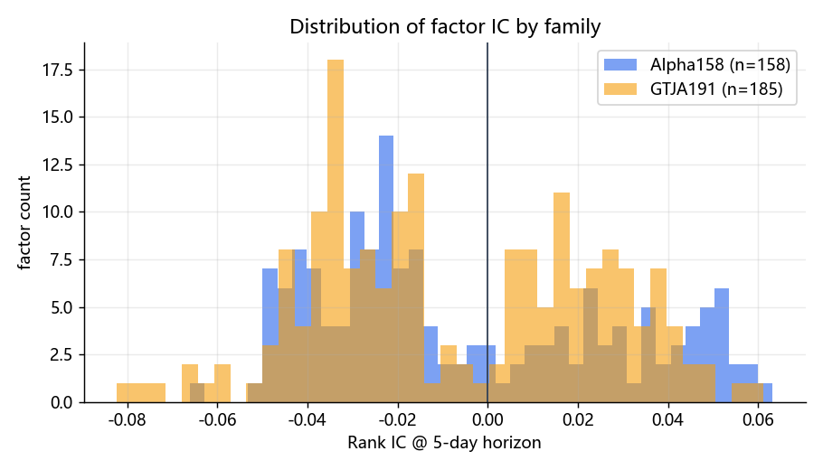</p>

> 两族 IC@5 分布。均值 |IC@5| ≈ **0.030（Alpha158）** vs **0.028（GTJA191）**，均有 ~97% 的因子 |t| > 2。
> 最强的是**成交额波动**（alpha070/095）、**低波动/振幅**（KLEN/STD）、**中期反转**（MIN60/QTLD）。

**相关性**：全体平均 |corr| ≈ **0.226**（中等，仅 4.8% 的对 > 0.7）。发现若干**跨库完全重复**的因子
（如 Alpha158 `IMAX20` ≡ GTJA `alpha177`、`VMA20` ≡ `alpha168`），互相印证两套实现正确。

<p align="center">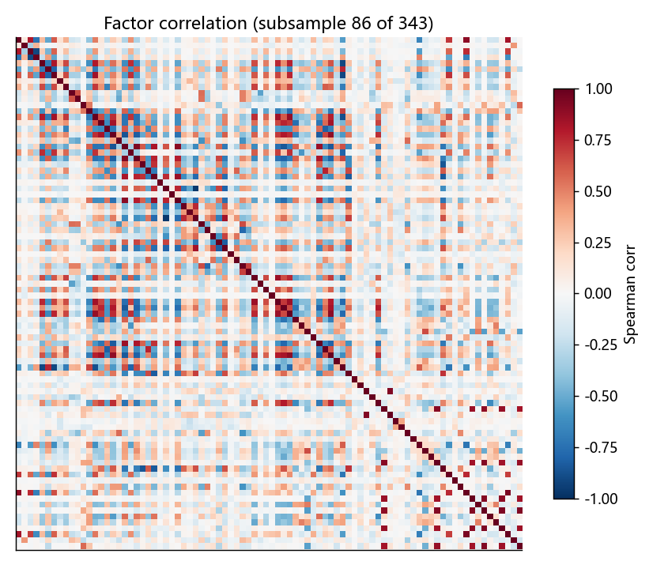</p>

---

## 2. 因子在哪里有效

**市值分组（10 分位）**：有效性随市值**近单调下降**——在**小市值**最强、大盘最弱（D1 0.032 · **D2 0.040 峰值** · … · D10 0.016，约 2.4× 差）。

<p align="center">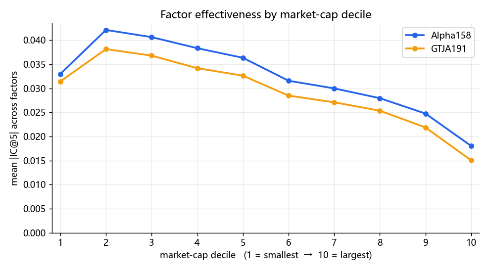</p>

**指数成分分组**：**中证1000** 最"因子友好"（|IC| 0.031），远高于中证500/创业板/沪深300。

<p align="center">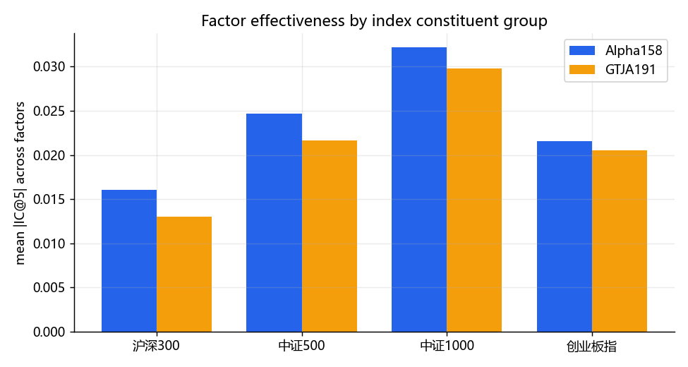</p>

**分年趋势**：符号常年稳定，2022–2023 加深；波动率类因子近年走强。

<p align="center">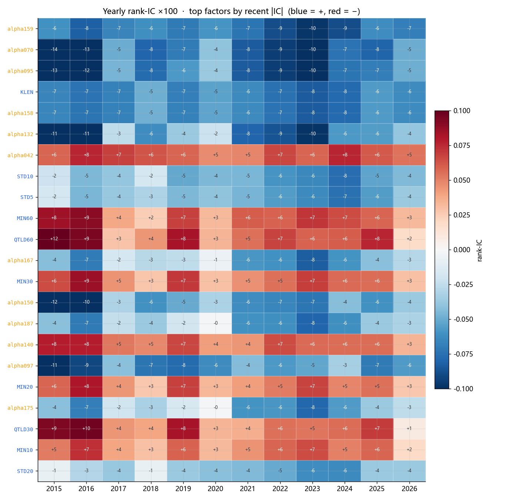</p>

---

## 3. 信号持续性与调仓频率

**累计 IC**（每日 IC 的累加）近乎一条直线 → 预测力**极其稳定**；成交额波动类累计最高。

<p align="center">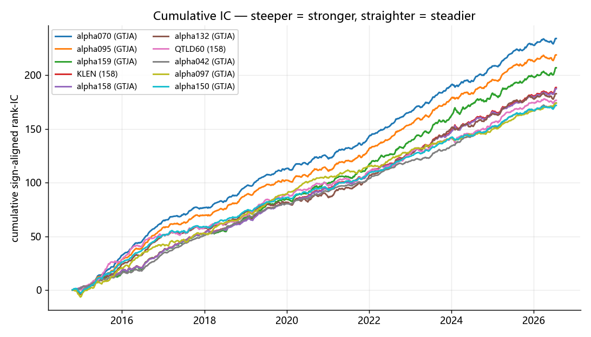</p>

**IC vs 持有期**：|IC| 在 **~30–40 天见顶**，效率 |IC|/√h 在 1 天最高 → 计入成本后 **月频（~20天）是甜点**。

<p align="center">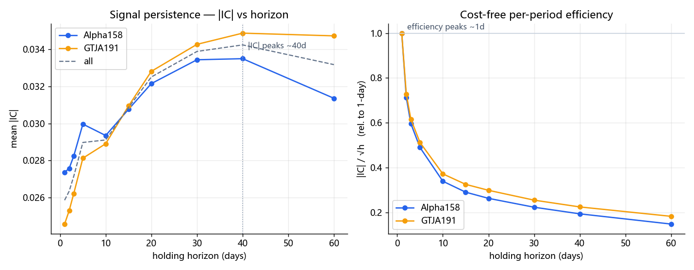</p>

---

## 4. 单因子 10 分层回测

纯因子、无模型：每月按单个因子值把股票分 10 组等权持有。**好因子 → 10 条净值线单调张成扇形。**

<p align="center">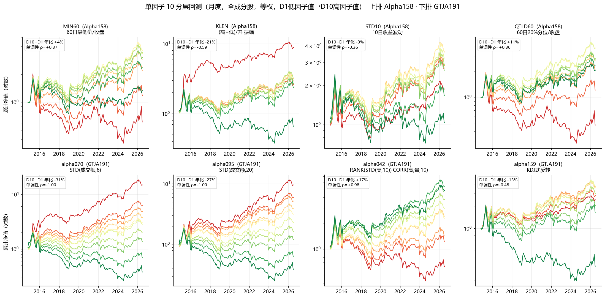</p>

> **GTJA191 的成交额波动因子最干净**：`alpha070`、`alpha095` 单调性 **ρ = −1.00**（完美单调），`alpha042` **ρ = +0.98**；
> Alpha158 的 `KLEN` 靠极端组（最低振幅）驱动，中间分辨率一般。

---

## 5. LightGBM 走查选股

- **特征**：全部 158 个 Alpha158（逐月截面 z-score）。**票池**：中证1000（剔最小 10%）。**调仓**：月频。
- **走查**：滚动 **3 年训练 → 预测 1 年**，训练窗末 6 个月做验证（**自定义 IC 早停** + 小网格调参）。
- **标签**：下月收益的**截面 z-score**（学相对 alpha，而非择时）。**分 20 组**，多空 = G20−G1。

<p align="center">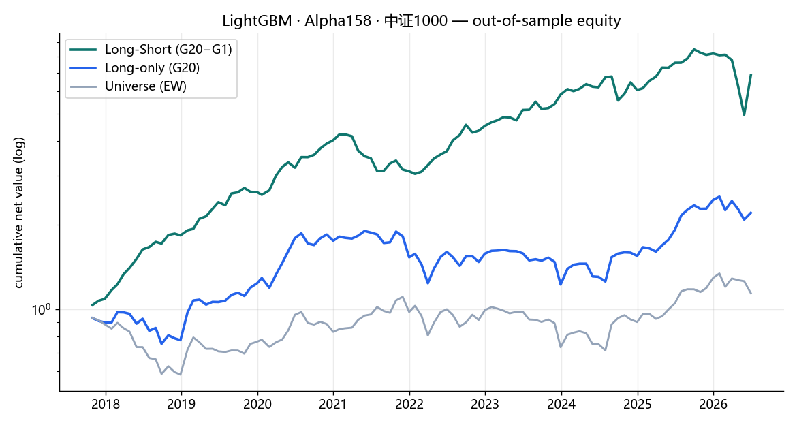</p>
<p align="center">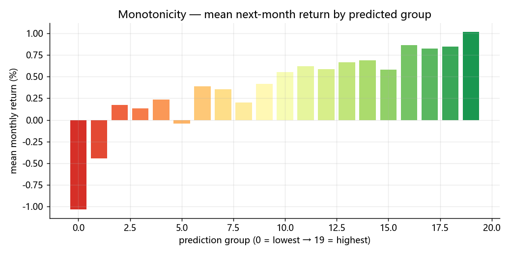</p>

> **样本外（2017-10 → 2026-06，105 个月，税前）**：多空 **+24.6%/年、Sharpe 1.06**；纯多头 **+9.5%/年**；
> 月度 rank-IC **0.070（ICIR 0.63, t=6.5）**；20 组收益从 −1.0%/月 单调升到 +1.0%/月。

---

## 6. 组合权重优化

多头组不再等权，而是用 **Ledoit-Wolf 收缩协方差** 做**均值-方差优化（MVO）**（只做多、满仓、单票 ≤ 8%、
风险 ≤ 等权组合方差）。

<p align="center">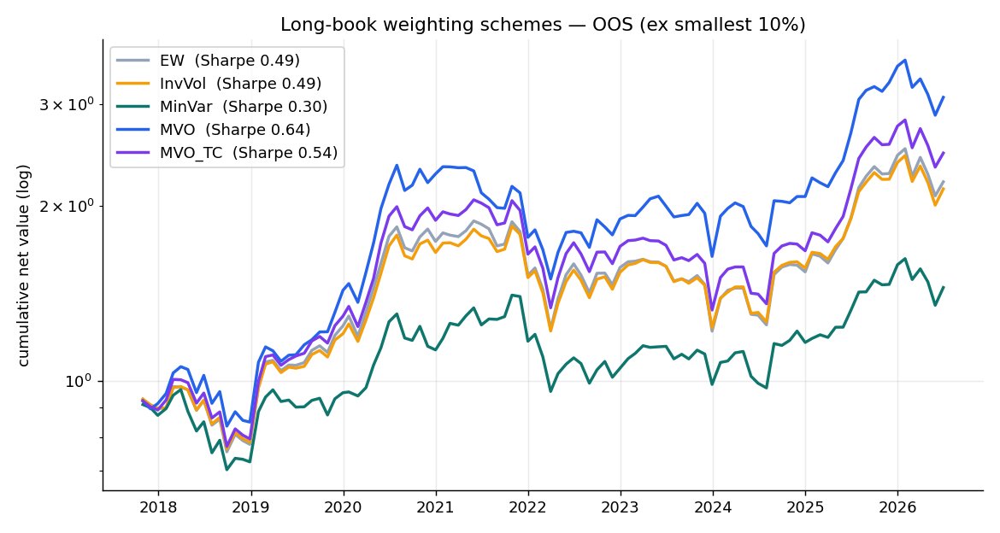</p>

> **等风险下最大化 α**：纯多头 **9.5% → 13.7%/年、Sharpe 0.49 → 0.64**。最小方差会把 alpha 丢掉（别用）。

---

## 7. 股票池 × 频率 对比

同一套模型，只改**股票池**与**调仓频率**（税前）：

<p align="center">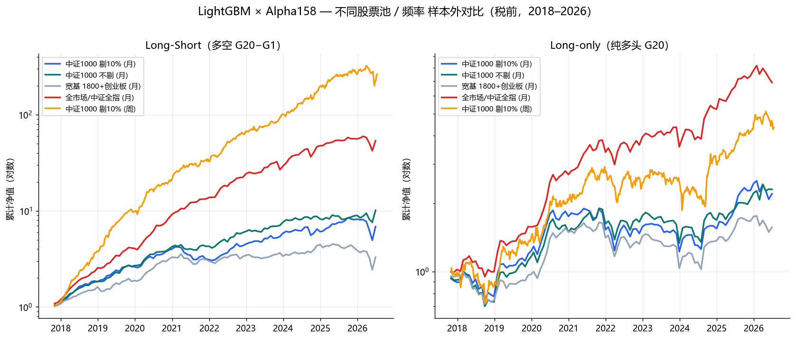</p>

| 配置 | 多空年化 | 多空夏普 | 纯多头年化 | IC | 年化换手 |
|---|---|---|---|---|---|
| 中证1000 剔10% (月) | +24.6% | 1.06 | +9.5% | 0.070 | 11× |
| 中证1000 不剔 (月) | +30.3% | 1.50 | +10.1% | 0.065 | 11× |
| 宽基 1800+创业板 (月) | +14.6% | 0.73 | +5.3% | 0.049 | 11× |
| 全市场/中证全指 (月) | **+57.7%** | **2.27** | +24.7% | **0.089** | 11× |
| 中证1000 剔10% (周) | **+91.5%** | **3.01** | +18.7% | 0.071 | **42×** |

> **票池越下沉、频率越高，税前越强，但超额越来自不可交易的微盘 / 换手成本越高。**
> 全市场和周频是"信号强度上限"，不是可落地策略。

---

## 核心结论 Key findings
1. **两套因子都有效且高度一致**——最强的是成交额波动、低波动、价格振幅、中期反转；Alpha158 平均略强，GTJA191 贡献最干净的单调因子。
2. **因子在小盘最有效**：市值分位单调下降，中证1000 是甜点；加大盘稀释、加微盘增强但不可交易。
3. **信号持续、偏中周期**：累计 IC 近线性，|IC| 约 1–2 个月见顶 → 计成本后**月频**最优。
4. **ML 能显著放大因子**：中证1000 月频多空 +24.6%/Sharpe 1.06；权重优化再加 ~4pp。
5. **一切皆税前**：微盘、高换手最不抗成本，落地要以纯多头 + 月频 + 干净票池为基准。

---

## 代码结构 Repo structure

| 文件 | 作用 |
|---|---|
| `config.py` | 全局配置（区间、指数代码、参数） |
| `data_loader.py` | Tushare 抓取 + parquet 缓存（多线程、可续传、可选全市场） |
| `operators.py` | 向量化算子库（rank / ts-ops / 相关 / 滚动 OLS / DECAYLINEAR / SMA·WMA / REGBETA），列分块省内存 |
| `alpha158.py` | **Alpha158** 因子构造（158 个，支持流式 sink） |
| `gtja191.py` | **GTJA-191** 因子构造（186 个，逐 alpha 容错） |
| `panel.py` / `factor_test.py` | 宽表面板、前向收益、分组掩码；rank-IC 与相关矩阵 |
| `run_stream.py` | 流式主驱动：构造→筛选→IC（整体/市值/指数）→相关 |
| `run_mktcap.py` / `run_yearly.py` / `run_horizon.py` / `run_dailyic.py` | 市值十分位 / 分年 IC / 持有期衰减 / 每日 IC 矩阵 |
| `factor_decile.py` | **单因子 10 分层回测**（纯因子，无 ML） |
| `build_monthly.py` | 月频/周频 ML 数据集（票池可切：ZZ1000 / BROAD / ALL） |
| `ml_lgbm.py` | **LightGBM 走查** + 20 组多空/纯多头回测 + 持仓记录 |
| `portfolio_opt.py` | **组合权重优化**（EW / InvVol / MinVar / MVO / MVO+换手上限，cvxpy） |
| `compare_all.py` | 多票池×频率**一图对比** |
| `finalize.py` / `make_report.py` / `build_artifact.py` / `build_ml_artifact.py` | 汇总、画图、生成 HTML 报告 |

参数化开关（环境变量）：`FR_UNIV`（ZZ1000/BROAD/ALL）、`FR_DROP`（剔最小市值比例）、`FR_FREQ`（M/W）、
`FR_TAG`（输出后缀）、`FR_PPY`/`FR_TRAIN`/`FR_TEST`/`FR_VALID`（走查窗口）。

---

## 如何运行 How to run

```bash
# Python 3.10 环境
pip install -r requirements.txt
# 配置 Tushare token（一次即可）
python -c "import tushare as ts; ts.set_token('YOUR_TUSHARE_TOKEN')"

# 部分环境下 scipy/alphalens 会因 MKL/OpenMP 冲突原生崩溃，加这层保护：
export KMP_DUPLICATE_LIB_OK=TRUE MKL_NUM_THREADS=1 OMP_NUM_THREADS=1 MKL_THREADING_LAYER=SEQUENTIAL

# 1) 抓数（首次约 20–35 分钟，之后走缓存）
python -c "import data_loader as dl; dl.get_daily_panel()"
# 2) 因子构造 + IC/相关
python run_stream.py && python finalize.py
# 3) 单因子分层回测
python factor_decile.py
# 4) ML 策略（中证1000 剔10% 月频）
python build_monthly.py && python ml_lgbm.py && python portfolio_opt.py
# 5) 报告与对比图
python make_report.py && python compare_all.py
```

切换票池/频率示例：
```bash
FR_UNIV=ALL  FR_DROP=0.0 FR_TAG=_all python build_monthly.py     # 全市场（需先抓全市场面板）
FR_FREQ=W FR_PPY=52 FR_TRAIN=156 FR_TEST=52 FR_VALID=26 FR_TAG=_wk python ml_lgbm.py   # 周频
```

---

## 局限与免责 Caveats & disclaimer
- 所有曲线**税前、未做行业/市值中性化**；因子部分为 **IC / 分层**，非组合实盘。
- 微盘、高换手、可融券等假设**在实盘不可得**，全市场/周频结果只作信号上限参考。
- 票池为指数成分并集，含轻微幸存者偏差；5 个 GTJA alpha 因需要因子/基准收益被排除。
- **仅供研究与学习，不构成任何投资建议。** Research / education only — **not investment advice.**

---

<sub>Built with Tushare Pro · qlib Alpha158 · GTJA-191 · alphalens-reloaded · LightGBM · cvxpy.</sub>
